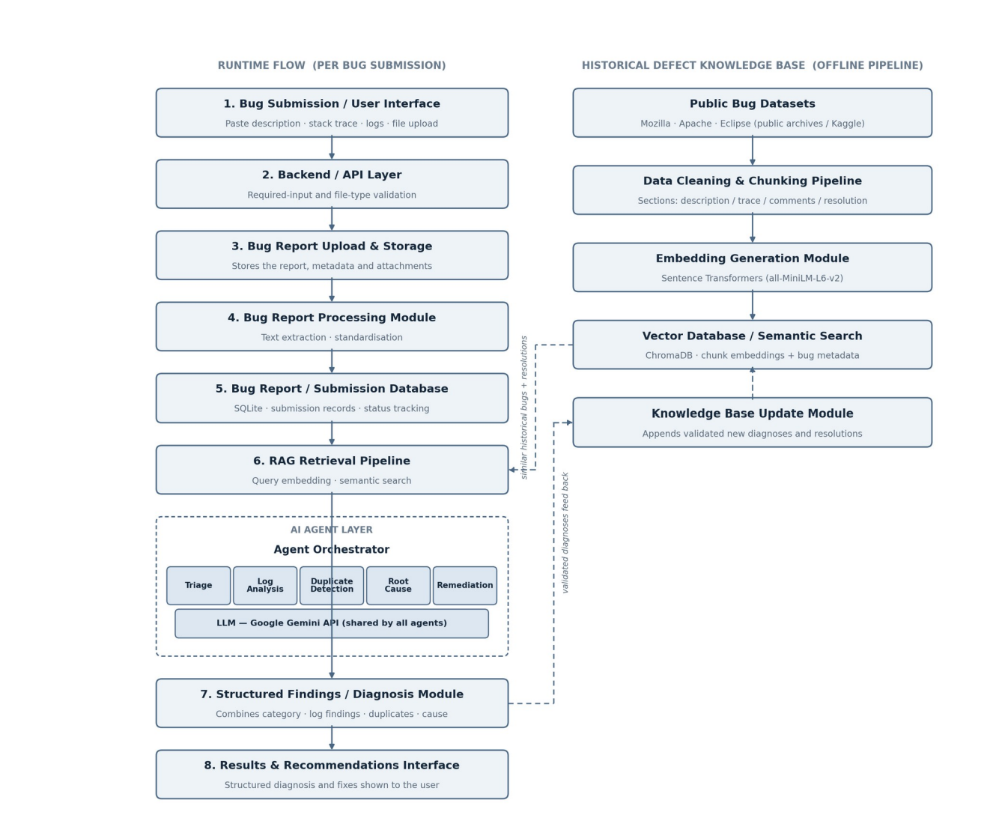

# System Architecture – Intelligent Bug Diagnosis Platform

## 1. System Overview

The Intelligent Bug Diagnosis Platform is designed to analyse software bug reports and provide possible root causes and fix recommendations using historical defect knowledge.

The system follows a Retrieval-Augmented Generation (RAG) architecture supported by five specialised agents. It accepts bug descriptions, stack traces, logs and uploaded files, retrieves relevant historical defects, and combines the findings to generate diagnosis assistance.

## 2. System Architecture Diagram

## 3. Main System Components

### 3.1 Bug Submission Module
- Accepts bug descriptions through direct text input.
- Collects stack traces and error logs.
- Supports uploading bug report files.
- Validates and stores submitted reports.

### 3.2 Backend and Processing Layer
- Handles submitted bug reports.
- Coordinates processing and communication between system components.
- Prepares bug information for analysis and retrieval.

### 3.3 Historical Defect Knowledge Base
- Contains historical defect reports collected from Mozilla, Apache and Eclipse sources.
- Stores cleaned and standardised bug information.
- Divides defect information into manageable text chunks.
- Generates vector embeddings using Sentence Transformers.
- Stores embeddings, documents and metadata in ChromaDB.

### 3.4 Agent Orchestrator
- Coordinates the five specialised agents.
- Controls the order of analysis.
- Passes relevant information between agents.
- Combines individual agent findings into a structured diagnosis.

### 3.5 Results and Recommendation Module
- Displays bug classification and priority.
- Presents log analysis and possible root causes.
- Shows similar historical defects.
- Provides suggested debugging actions and possible fixes.

## 4. Agent Responsibilities

The platform consists of five specialised agents.

### 4.1 Triage Agent
- Examines the submitted bug report.
- Identifies the probable defect category.
- Estimates bug priority and severity.
- Organises the initial bug information for further analysis.

### 4.2 Log Analysis Agent
- Examines error logs and stack traces.
- Identifies exceptions, error messages and suspicious execution patterns.
- Extracts useful technical information for diagnosis.

### 4.3 Duplicate Detection Agent
- Compares the submitted bug with historical defect reports.
- Uses semantic similarity and vector retrieval.
- Identifies potentially duplicate or related issues.
- Provides relevant historical bug references.

### 4.4 Root Cause Analysis Agent
- Analyses the submitted bug information.
- Uses findings from log analysis and historical defect retrieval.
- Identifies possible causes of the reported problem.
- Provides evidence-based root-cause hypotheses.

### 4.5 Remediation Agent
- Examines the diagnosis and historical resolutions.
- Suggests possible debugging steps.
- Recommends potential fixes based on available evidence.
- Presents recommendations for developer review.

## 5. Agent Orchestration and Execution Flow

The Agent Orchestrator coordinates the execution of all five agents.

The workflow follows these steps:

1. The user submits a bug report through the Bug Submission Module.
2. The system validates and stores the submitted information.
3. The Triage Agent identifies the probable category and priority.
4. The Log Analysis Agent examines the stack trace and error logs.
5. The Duplicate Detection Agent retrieves similar historical defects from ChromaDB.
6. The Root Cause Analysis Agent analyses the available evidence and identifies possible causes.
7. The Remediation Agent generates debugging suggestions and potential fixes.
8. The Agent Orchestrator combines the findings.
9. The Results Module displays the diagnosis and recommendations to the user.

## 6. Data Flow

### 6.1 Bug Diagnosis Flow

User Input → Bug Submission Module → Backend Processing → Agent Orchestrator → Five Specialised Agents → Diagnosis and Recommendations → Results Interface.

### 6.2 Historical Knowledge Base Flow

Public Bug Sources → Data Collection → Data Cleaning and Standardisation → Text Chunking → Embedding Generation → ChromaDB Vector Indexing → Semantic Retrieval.

### 6.3 Retrieval-Augmented Generation Flow

Submitted Bug → Query Embedding → ChromaDB Similarity Search → Relevant Historical Defects → Diagnosis Context → Agent Analysis → Fix Recommendations.

## 7. Data Models

### 7.1 Bug Report Schema

The bug report schema represents a newly submitted software defect.

| Field | Description |
|---|---|
| bug_id | Unique identifier for the submitted bug |
| title | Short summary of the reported issue |
| description | Detailed explanation of the problem |
| category | Identified defect category |
| priority | Estimated priority of the bug |
| stack_trace | Technical execution trace |
| error_logs | Associated error messages and logs |
| file_path | Reference to an uploaded file, if applicable |
| status | Processing or diagnosis status |
| created_at | Submission timestamp |

### 7.2 Historical Defect Schema

The historical defect schema represents previously reported software issues stored in the knowledge base.

| Field | Description |
|---|---|
| chunk_id | Unique identifier for the stored text chunk |
| bug_id | Original historical bug identifier |
| project | Source project such as Mozilla, Apache or Eclipse |
| component | Software component associated with the defect |
| title | Historical bug title |
| content | Description and relevant defect information |
| chunk_type | Type of stored text chunk |
| resolution | Recorded resolution, if available |
| source_url | Original issue reference |

### 7.3 Vector Database Representation

Each indexed historical defect contains:

- Unique record identifier.
- Text document or chunk.
- Numerical embedding vector.
- Metadata describing the original defect.

The Sentence Transformers model `all-MiniLM-L6-v2` generates 384-dimensional embeddings. ChromaDB stores the embeddings, documents and metadata for similarity-based retrieval.

## 8. Technologies Used

| Component | Technology |
|---|---|
| Programming Language | Python |
| User Interface | Streamlit |
| Proposed Backend API | FastAPI |
| Embedding Model | Sentence Transformers – all-MiniLM-L6-v2 |
| Vector Database | ChromaDB |
| Orchestration Framework | LangChain (proposed) |
| LLM Integration | Google Gemini API (proposed) |
| Local Data Storage | SQLite |
| Version Control | Git and GitHub |

## 9. Implementation Status

The architecture describes the intended system design. The current prototype has implemented bug submission, local storage, historical defect collection and cleaning, embedding generation, ChromaDB indexing and initial semantic retrieval testing.

The five-agent workflow is being developed incrementally. FastAPI, LangChain and Google Gemini integration remain proposed components until implemented and tested.

## 10. Expected Output

The platform is expected to provide:

- Bug category and priority.
- Analysis of stack traces and error logs.
- Similar historical defect reports.
- Possible root causes.
- Suggested debugging actions.
- Potential fix recommendations.

### Knowledge Base Update and Feedback Loop

The platform includes a feedback loop to improve the historical defect knowledge base over time.

1. The AI agents generate structured findings, root cause hypotheses, and recommended fixes.
2. Developers review and validate the diagnosis and resolution.
3. Validated bug reports and resolutions can be selected for knowledge-base updates.
4. The Knowledge Base Update Module prepares the validated information.
5. The information is converted into embeddings and stored in ChromaDB.
6. Future bug submissions can retrieve this information through semantic search.

### LLM Integration

The Agent Orchestrator coordinates the five agents and uses the Google Gemini API as the LLM service for AI-assisted analysis and fix recommendations. The API integration is part of the proposed architecture and should be marked as implemented only after it has been integrated and tested.